# ShellFolio

A Debian/XFCE-inspired terminal for exploring my electronics, embedded Linux,
and software projects.

[Open ShellFolio](https://yassinebkr.github.io/ShellFolio/) ·
[Read the launch sequence](launch-script.js)

[](https://yassinebkr.github.io/ShellFolio/)

## Explore

- **Start:** `./launch-interactive.sh` opens with an animated introduction.
- **Navigate:** type `help`, `projects`, `skills`, `ls`, or `inspect lora`.
- **Use shortcuts:** Run, Clean and project links sit below the output.
- **Use a keyboard:** Tab/→ complete commands; ↑/↓ browse history.
- **Copy output:** select text normally, then use your browser's copy action.

Shortcuts display their full command immediately, then reveal its result after
a **280 ms** pause. The introductory script has its own progressive animation.

## Make it yours

Edit [`portfolio.config.js`](portfolio.config.js) to change the shortcuts
and add read-only predefined responses. The
[customization guide](docs/CUSTOMIZATION.md) walks through each step.

The README's SVG is generated with [`tools/make_demo.py`](tools/make_demo.py).
It replays commands through the same JavaScript interpreter as the website.
Timing is configured in [`tools/demo_timing.py`](tools/demo_timing.py):
a blank prompt appears shortly after each response, with a short pause before
the next command is typed.

## Develop

```bash
python3 -m http.server 8000
# Open http://localhost:8000/
```

To run the tests and regenerate the README SVG:

```bash
npm test
python3 -m unittest discover -s tests -p 'test_demo_timing.py'
npm run demo
```

GitHub Pages publishes the site from `main` at the repository root.

[Architecture and developer guide](docs/DEVELOPMENT.md) ·
[Customization guide](docs/CUSTOMIZATION.md) ·
[Credits](docs/CREDITS.md)

## Related work

The [GitHub profile terminal SVG generator](https://github.com/yassinebkr/test)
is a **separate project** (currently private, intended for a future public
release). ShellFolio contains the interactive website and its own README demo.

Originally inspired by [AienTech](https://github.com/AienTech/aientech).
Debian artwork comes from [Simple Icons](https://github.com/simple-icons/simple-icons/blob/develop/icons/debian.svg);
see [asset credits](docs/CREDITS.md).
