# ShellFolio

An interactive, Debian/XFCE-style terminal portfolio running in the browser.

[**Open the live terminal**](https://yassinebkr.github.io/ShellFolio/) · [**Run the README launcher**](https://yassinebkr.github.io/ShellFolio/?run=launch)

[](https://yassinebkr.github.io/ShellFolio/)

The animation above replays four commands through ShellFolio's **real virtual command interpreter**: `ls -l ~/workspace`, `cd workspace/projects`, `ls`, and `inspect lora`. It is generated from actual interpreter responses by [`tools/make_demo.py`](tools/make_demo.py), and contains only SVG/CSS.

## Features

ShellFolio provides a read-only virtual filesystem with `ls -l`, `cd`, `cat`, `tree`, `pwd`, `projects`, and `inspect`, plus shell-style history and live completion suggestions. Type `pr` to see `projects` suggested inline, then press **Tab** or **→** to accept it. The responsive interface follows the visual conventions of XFCE Terminal on Debian 13.

The normal website URL and the README launcher (`?run=launch`) both start by typing and running the simulated command `./launch-interactive.sh`; it displays a short introduction, while the on-screen suggestions let visitors explore without typing. No real shell script is executed. The launcher streams its output as a short, interruptible terminal sequence, with in-place ASCII progress indicators and incremental text. The active Bash prompt appears only when the script completes or is interrupted. Press **Esc** to show the remaining output immediately or **Ctrl+C** to interrupt. Reduced-motion preferences show the results without animation. The original file listing can still be opened via [`?view=listing`](https://yassinebkr.github.io/ShellFolio/?view=listing).

The simulation presents curated engineering data; it executes entirely in the browser and uses no backend shell or arbitrary system command execution.

## Customization

To adapt **Run**, **Clean**, other suggested commands and predefined responses, edit `portfolio.config.js`. XFCE menu labels remain visual-only. The [customization guide](docs/CUSTOMIZATION.md) walks through the setup and validation.

## Run locally

```bash
python3 -m http.server 8000
```

Visit <http://localhost:8000/>. Automated tests and SVG regeneration use Node.js and Python 3:

```bash
npm test
npm run demo
```

The deployable site is at the repository root (`index.html`, `style.css`, `app.js`, `engine.js`, `assets/`). The unit tests, demonstration generator, CI configuration, and documentation live alongside that site **in this repository**. GitHub Pages publishes `main` / `(root)`.

Read [Development & architecture](docs/DEVELOPMENT.md) for the design and testing approach.

## Related project

The [animated SVG terminal for a GitHub profile](https://github.com/yassinebkr/test) is a separate Python-generated project. Its current source repository is private and is planned for public release under a new name. ShellFolio focuses exclusively on the interactive browser experience.

## Credits

This project grew out of a GitHub terminal profile experiment inspired by [AienTech](https://github.com/AienTech) and the [AienTech/aientech](https://github.com/AienTech/aientech) repository. The original animated SVG work was an inspiration; ShellFolio's browser interface and virtual shell are independent implementations.

The Debian swirl vector is derived from [Simple Icons — Debian](https://github.com/simple-icons/simple-icons/blob/develop/icons/debian.svg). See the [Debian logo guidelines](https://www.debian.org/logos/) and [asset credits](docs/CREDITS.md).
