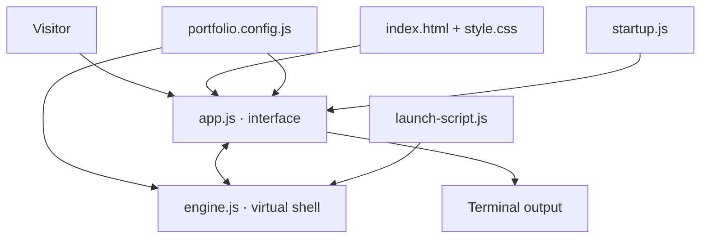
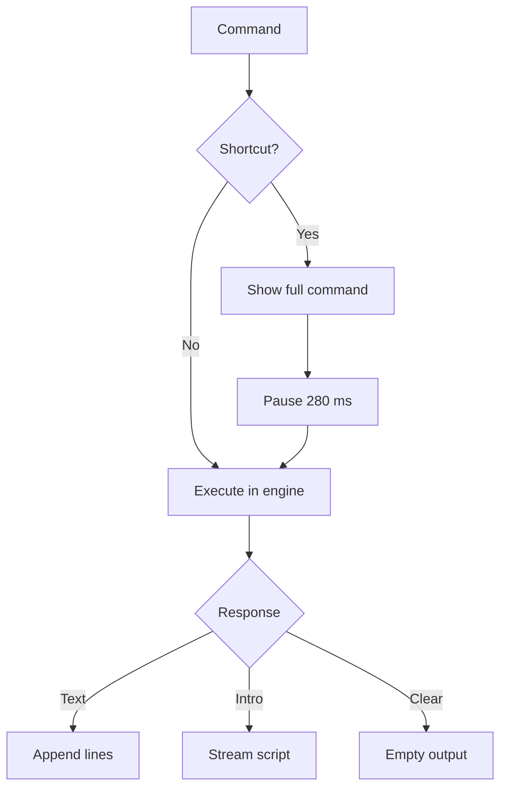

# Development and architecture

ShellFolio is a client-side terminal portfolio. Its command parser works with
a virtual filesystem, not the visitor's machine.

## Source map

| Area | File |
| --- | --- |
| XFCE window and responsive styles | `index.html`, `style.css` |
| Browser events, input and rendering | `app.js` |
| Command interpreter and virtual files | `engine.js` |
| Shortcuts and custom responses | `portfolio.config.js` |
| Introductory command sequence | `launch-script.js` |
| Shared `neofetch` display | `index.html` → `.sysfetch`, cloned by `app.js` |
| Direct, profile-continuation and listing routes | `startup.js` |
| Node unit tests | `tests/engine.test.mjs` |
| Verification workflow | `.github/workflows/verify.yml` |

## Browser architecture



The interpreter returns structured text and vetted links. The browser renders
them as DOM nodes. The XFCE menu labels and window controls are decorative.

## Command lifecycle



| Interaction | Behavior |
| --- | --- |
| Typed command | Execute immediately on Enter |
| Shortcut | Echo immediately, then display results after 280 ms; restore editable prompt and keyboard focus |
| Intro playback | Hide the active input until completion; focus the prompt when ready |
| Escape | Finish the intro and focus the prompt, including after Run replay |
| Ctrl+C | Copy selected text, otherwise interrupt playback |
| Tab / → | Accept unique command completion |
| ↑ / ↓ | Browse command history |
| `neofetch` | Render the complete Debian profile and palette, as on initial load |
| Type during intro | Finish the intro and preserve the first typed character |

The initial introduction focuses the command input once it finishes, allowing
immediate keyboard use. Typing while it is still playing finishes the intro
and preserves the first character. Clicking elsewhere or selecting text
disables the automatic focus. **Escape** explicitly finishes the current
introduction and focuses the ready prompt, unless a text selection is active.
Regular commands do not steal focus.

Shortcut completion (including `Clear` and `Run`) uses one
`restorePrompt()` path that clears `readOnly` and `hidden` before focusing.
While a script or another shortcut is still active, it waits instead of
restoring prematurely. Clicking elsewhere or selecting output disables
shortcut autofocus.

### Neofetch rendering

The initial Debian profile lives in `index.html` as `.sysfetch`. On load,
`app.js` preserves a copy of that element, then clones it whenever the
interpreter returns `view: 'system-profile'`. Typed and shortcut commands
use the same path, even after `clean`.

The cloned profile must use `white-space: normal`. Shell output uses
`pre-wrap`, which would otherwise expand markup whitespace into blank gaps.

The interpreter also supplies plain text lines for non-browser consumers.
Edit the `.sysfetch` markup to change the visual profile; keep the fallback
text in `engine.js` in sync. The separate `github-profile-terminal-svg`
generator also has a matching `Projects` field. No new browser renderer
or generated SVG is involved in this app.

## Run and verify

```bash
python3 -m http.server 8000
npm test
node --check app.js
node --check engine.js
node --check launch-script.js
node --check portfolio.config.js
```

GitHub Actions validates the interactive application. GitHub Pages publishes
`main` / `/(root)`.

The default URL starts the introductory script immediately. Links from the
GitHub profile use `?run=launch`: `app.js` keeps the initial `neofetch`
markup, reconstructs the same `ls -l ~/workspace` listing shown at the end
of the profile SVG, then types `./launch-interactive.sh` and plays its
existing animation. This handoff preserves the final SVG scene rather than
repeating its earlier commands. `?view=listing` displays the listing without
launching the script, and takes precedence when both parameters are present.
The virtual listing uses the same five directory names and dates as the
generated profile SVG. The default route, Run shortcut, input focus and Escape
handling otherwise remain unchanged.

See [customization](CUSTOMIZATION.md) to replace the showcased projects.
