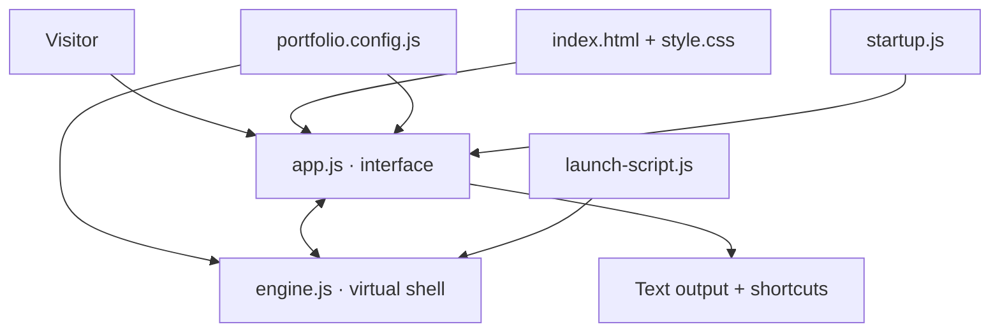
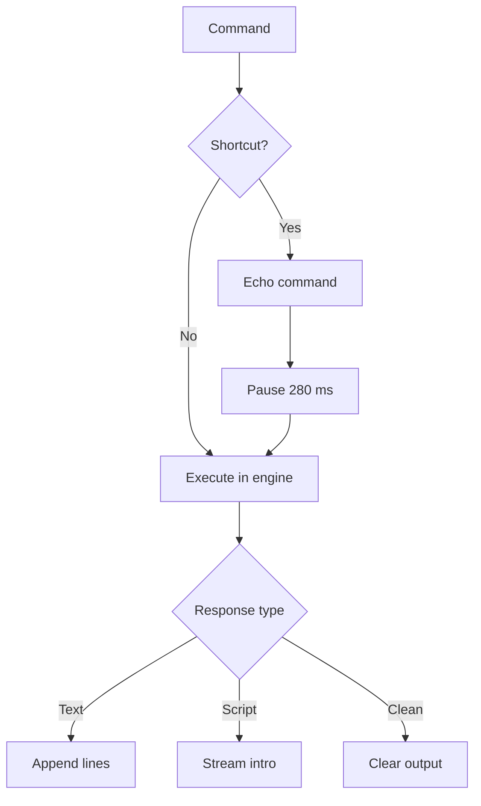
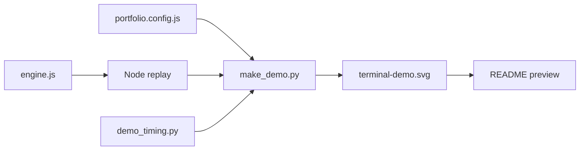

# Development and architecture

ShellFolio is a **static, read-only virtual terminal**. It does not execute
Bash or access the visitor's filesystem.

## Source map

| Area | Owner |
| --- | --- |
| Window and responsive layout | `index.html`, `style.css` |
| Interaction, rendering, keyboard | `app.js` |
| Commands, completion, virtual files | `engine.js` |
| Shortcut labels and custom responses | `portfolio.config.js` |
| Introductory scripted output | `launch-script.js` |
| Initial URL behavior | `startup.js` |
| README demo generator | `tools/make_demo.py` |
| README animation timing | `tools/demo_timing.py` |

## 1. Browser architecture



The interpreter returns structured text, links, and optional script timelines.
The DOM renderer uses text nodes and curated links, never arbitrary HTML.
The XFCE window controls and menu labels are intentionally decorative.

## 2. Command lifecycle



| Behavior | Rule |
| --- | --- |
| Manual input | Execute immediately on Enter |
| Shortcut | Echo at once; show the response after 280 ms |
| Introductory script | Hide the active prompt until completion/interruption |
| Selecting text | Never steal focus or scroll the selection away |
| Ctrl+C | Copy selected text; otherwise interrupt an active script |
| Esc | Finish the active introduction |
| Reduced motion | Skip decorative delays and typing animations |

Commands include `help`, `ls`, `cd`, `pwd`, `cat`, `tree`, `projects`,
`skills`, `inspect`, `history`, `run`, `clean` and `clear`. Tab or →
accepts a unique completion; ↑/↓ navigates history.

## 3. README SVG pipeline



The SVG is **a generated image**, not the browser application. It cannot
receive button clicks. GitHub Actions reruns the generator and rejects a
tracked SVG that differs from the generated output.

### Animation rules

| Concern | Contract |
| --- | --- |
| Terminal rows | 21 px per actual output line; no invented blank rows |
| Geometry | Derived from output row count, independent of timing |
| Execution latency | Simulated by command category |
| Prompt visibility | New empty prompt appears **60 ms** after the response |
| Pause before typing | About **190–220 ms** after the previous response |
| Typing time | Depends on command length, capped at 850 ms |
| End of animation | Keep the last frame; only the cursor blinks |
| Shortcut strip | Drawn from `portfolio.config.js` beneath the last prompt |

Change the execution and pause values in `tools/demo_timing.py`. This is not
a benchmark of real shell commands. The `cd` and `ls` delays are intentionally
small; `inspect` is slightly slower for readability.

### Build checks

```bash
npm test
python3 -m unittest discover -s tests -p 'test_demo_timing.py' -v
npm run demo
git diff --check
git diff --exit-code -- assets/terminal-demo.svg
```

The CI workflow also checks JavaScript syntax and parses the SVG as XML.

## 4. Ownership and publishing

**This repository:** the website, browser engine, configuration, tests,
generated README demo, and documentation.

**Separate repository:** the Python generator for the GitHub *profile*
terminal, currently at [yassinebkr/test](https://github.com/yassinebkr/test).

For GitHub Pages, publish `main` / `/(root)`. The normal URL starts the
read-only introduction. Use `?view=listing` for the original directory
listing; `?run=launch` also starts the introduction.

See the [customization guide](CUSTOMIZATION.md) for editing and deployment.
